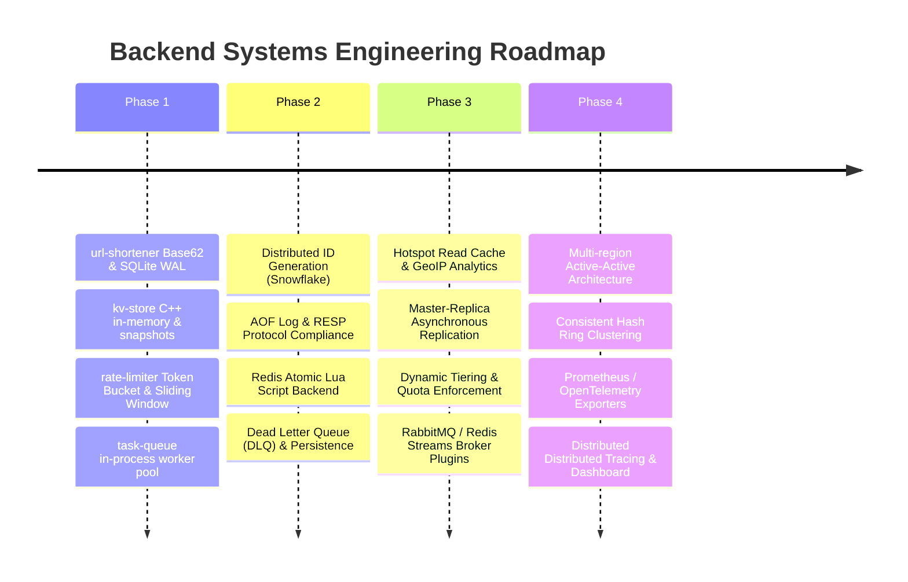

# Mini Projects: Backend Systems Engineering Portfolio

[](https://github.com/ErenYeager1836/mini-projects/actions)
[](LICENSE)
[](kv-store/)
[](pyproject.toml)

A production-grade, modular monorepo containing four fundamental backend systems and infrastructure tools built for software engineering and backend systems portfolio demonstration.

Each project explores a foundational pattern in modern distributed architecture, database internals, and concurrency:

---

## Master Projects Directory

| # | Project | Stack | Domain | Key Capabilities | Design Note | Automated Tests | Folder |
| :---: | :--- | :--- | :--- | :--- | :---: | :---: | :--- |
| **1** | **`url-shortener`** | FastAPI, SQLite (WAL Mode), Pydantic | Web Services & API Design | Base62 encoding (56.8B combinations), custom vanity aliases, TTL expiration, HTTP 307 temporary redirects, click telemetry tracking, and scheme whitelisting | [DESIGN.md](url-shortener/DESIGN.md) | **9/9 Pytest** | [`url-shortener/`](url-shortener/) |
| **2** | **`kv-store`** | C++17, Winsock2 / POSIX Sockets, CMake | Database Internals & Networking | Redis-compatible TCP server supporting `SET`, `GET`, `DEL`, `EXPIRE`, `TTL`, `KEYS`, `SAVE`, `PING`, `QUIT`; reader-writer locking (`std::shared_mutex`), passive + active key expiration, length-prefixed snapshot persistence, and interactive CLI client | [DESIGN.md](kv-store/DESIGN.md) | **6/6 C++ Tests** | [`kv-store/`](kv-store/) |
| **3** | **`rate-limiter`** | Python 3, Standard Library | Distributed Systems & Traffic Shaping | Token Bucket (burst-tolerant) and Sliding Window Log (rolling window) algorithms, sync and async `@rate_limit` function decorator with custom key resolution, high-concurrency benchmarks (>600k ops/sec) | [DESIGN.md](rate-limiter/DESIGN.md) | **9/9 Pytest** | [`rate-limiter/`](rate-limiter/) |
| **4** | **`task-queue`** | Python 3, ThreadPool, Min-Heap, Queues | Asynchronous Job Processing & Resilience | In-process background worker thread pool, delayed/scheduled task execution, exponential backoff retries (`initial_delay * base ^ retry`), poison pill mitigation, and terminal status CLI dashboard | [DESIGN.md](task-queue/DESIGN.md) | **7/7 Pytest** | [`task-queue/`](task-queue/) |

---

## Monorepo Layout

```text
mini-projects/
├── .github/
│   └── workflows/
│       └── ci.yml             # GitHub Actions CI matrix (Ubuntu & Windows C++, Python 3.10-3.12)
├── url-shortener/             # Project 1: FastAPI + SQLite URL Shortener & Telemetry Engine
│   ├── url_shortener/
│   │   ├── app.py             # Route handlers and FastAPI factory
│   │   ├── database.py        # SQLite schema, WAL mode, queries
│   │   ├── models.py          # Pydantic request/response schemas
│   │   └── shortener.py       # Base62 generation
│   ├── tests/
│   │   └── test_shortener.py  # 9 unit & integration tests
│   ├── DESIGN.md              # Architectural design note
│   └── README.md
├── kv-store/                  # Project 2: Redis-compatible C++17 In-Memory Database
│   ├── CMakeLists.txt
│   ├── include/
│   │   ├── kv_protocol.hpp    # Text command parser and serializer
│   │   ├── kv_server.hpp      # TCP socket listener and worker dispatcher
│   │   ├── kv_store.hpp       # In-memory map, shared_mutex, TTL
│   │   └── net_utils.hpp      # Cross-platform socket abstraction
│   ├── src/
│   │   ├── main_server.cpp    # Standalone server CLI (kv_server)
│   │   ├── main_client.cpp    # Standalone client CLI (kv_client)
│   │   └── ...
│   ├── tests/
│   │   └── test_kv_store.cpp  # 6 unit, persistence, concurrency, and TCP tests
│   ├── DESIGN.md              # Database internals design note
│   └── README.md
├── rate-limiter/              # Project 3: Token Bucket & Sliding Window Python Library
│   ├── rate_limiter/
│   │   ├── base.py            # BaseRateLimiter and telemetry dataclasses
│   │   ├── benchmark.py       # Throughput and latency benchmarking CLI
│   │   ├── decorator.py       # @rate_limit decorator for sync/async functions
│   │   ├── sliding_window.py  # Sliding Window Log algorithm
│   │   └── token_bucket.py    # Token Bucket algorithm
│   ├── tests/
│   │   └── test_rate_limiter.py # 9 unit tests
│   ├── DESIGN.md              # Mathematical comparisons and trade-offs
│   └── README.md
├── task-queue/                # Project 4: In-Process Asynchronous Task Queue & Workers
│   ├── task_queue/
│   │   ├── cli.py             # Status table dashboard and interactive demo
│   │   ├── job.py             # Job lifecycle states and telemetry models
│   │   └── queue.py           # TaskQueue, delayed min-heap, and worker loops
│   ├── tests/
│   │   └── test_task_queue.py # 7 unit and integration tests
│   ├── DESIGN.md              # Backoff mathematics and broker comparison
│   └── README.md
├── pyproject.toml             # Root pytest configuration
├── LICENSE                    # MIT License
└── .gitignore                 # Monorepo build and bytecode ignore rules
```

---

## Quickstart: Running All Automated Tests

The monorepo contains **31 automated tests** across all 4 subprojects (6 C++ tests + 25 Python tests).

### 1. Run All 25 Python Tests (from monorepo root)
```bash
python -m pytest -v
```
*Output: 25 passed in ~3.25s*

### 2. Lint Python Codebase
```bash
flake8 url-shortener rate-limiter task-queue \
  --count --select=E9,F63,F7,F82 --show-source --statistics
```
*Output: 0 errors*

### 3. Build & Run C++ `kv-store` Tests

#### On Windows:
```powershell
cd kv-store
cmake -B build -S .
cmake --build build --config Release
.\build\Release\kv_tests.exe
```

#### On Linux / macOS:
```bash
cd kv-store
cmake -B build -S .
cmake --build build
ctest --test-dir build --output-on-failure
```

---

## Tool-by-Tool Overview & Demos

### 1. `url-shortener`
```bash
# Start API server
uvicorn url_shortener.app:app --host 127.0.0.1 --port 8000 --reload

# Shorten a URL
curl -X POST http://127.0.0.1:8000/api/shorten \
  -H "Content-Type: application/json" \
  -d '{"url": "https://fastapi.tiangolo.com", "custom_code": "fastapi"}'

# Test Redirection (HTTP 307)
curl -i http://127.0.0.1:8000/fastapi

# Inspect Click Analytics
curl http://127.0.0.1:8000/api/analytics/fastapi
```

### 2. `kv-store`
```bash
# Start TCP Server on port 6379 with snapshot persistence
./build/Release/kv_server -p 6379 -f dump.kv

# In another terminal, connect with the interactive client
./build/Release/kv_client -h 127.0.0.1 -p 6379
127.0.0.1:6379> SET user:101 "Nithishvelan" EX 10
+OK
127.0.0.1:6379> GET user:101
$Nithishvelan
127.0.0.1:6379> TTL user:101
:9
127.0.0.1:6379> SAVE
+OK
```

### 3. `rate-limiter`
```python
from rate_limiter import TokenBucketLimiter, rate_limit

limiter = TokenBucketLimiter(capacity=5, refill_rate=1.0)

@rate_limit(limiter, key_func=lambda ip, *args: ip)
def handle_request(ip: str):
    return f"Response for {ip}"
```
*Run benchmarks:*
```bash
python rate_limiter/benchmark.py --ops 100000 --threads 4
# Achieves >600,000 ops/sec with ~1.5us latency
```

### 4. `task-queue`
```bash
# Run real-time ASCII worker and status dashboard demonstration
python task_queue/cli.py demo
```
*Output:*
```text
==========================================================================
                      TASK QUEUE STATUS DASHBOARD                         
==========================================================================
Active Workers: 2/3 | Ready Queue Depth: 0
Total Jobs: 5 | Pending: 0 | Running: 1 | Success: 2 | Retrying: 1 | Failed: 1
--------------------------------------------------------------------------
Job ID     | Name                   | Status     | Retries  | Duration   | Result / Error
--------------------------------------------------------------------------
a8b21c4e   | multiply(6,7)          | SUCCESS    | 0/3      | 0.05s      | 42
f91a03d1   | multiply(12,12)        | SUCCESS    | 0/3      | 0.05s      | 144
e729b402   | payment_api            | RETRYING   | 1/3      | -          | ERR: Connection reset by p...
c581a910   | corrupt_batch_job      | FAILED     | 2/2      | -          | ERR: Unrecoverable databas...
==========================================================================
```

---

## Interview Highlights & Architectural Insights

1. **Why Base62 over Sequential IDs?**  
   Auto-increment integer IDs leak database growth rates and enable trivial enumeration attacks. Random Base62 provides non-guessable, URL-safe identifiers with negligible collision probability ($62^6 \approx 56.8\text{ billion}$ space).

2. **Reader-Writer Locks vs. Global Mutexes in C++**:  
   In caching workloads where reads dominate writes by 10:1 or more, standard mutexes serialize read access. `std::shared_mutex` allows multiple reader threads to inspect the cache concurrently without blocking each other.

3. **Why Sliding Window Log over Fixed Window?**  
   Fixed Window counters allow up to $2\times$ the rate limit if bursts occur across window boundaries (e.g. at 00:59 and 01:00). Sliding Window Log tracks rolling timestamps within $[now - W, now]$, enforcing strict invariant limits.

4. **Resilience with Exponential Backoff**:  
   Transient network errors recover over time. Exponential backoff prevents stampeding herd effects on recovering downstream services, while `max_retries` safeguards against poison pill payloads.

---

## Systems Engineering Roadmap

Each tool in this monorepo is engineered as a clean, working core system. Below is the multi-phase evolution roadmap for production scale:



### Detailed Subproject Roadmap

#### 1. `url-shortener`
- [x] Base62 encoding engine with 6-character entropy space ($62^6 \approx 56.8\text{B}$ URLs).
- [x] Custom vanity alias validation and collision handling.
- [x] SQLite WAL (Write-Ahead Logging) storage with automatic TTL expiry enforcement.
- [x] Real-time click analytics counter and timestamp tracking.
- [ ] **Distributed Key Generation**: Integrate a 64-bit Twitter Snowflake / ZooKeeper range coordination service for distributed worker nodes.
- [ ] **Hotspot Cache Layer**: Add a write-through Redis/LRU cache for high-frequency redirects to achieve sub-millisecond redirect latency.
- [ ] **Geographic & Referrer Analytics**: Extract GeoIP locations, device types, and referrer headers for rich telemetry dashboards.
- [ ] **Anti-Abuse Engine**: Google Safe Browsing API integration to prevent malicious redirects and phishing targets.

#### 2. `kv-store`
- [x] In-memory concurrent hash table with reader-writer locking (`std::shared_mutex`).
- [x] Active background expiration sweeps + passive on-access TTL eviction.
- [x] Multithreaded non-blocking TCP server and interactive CLI client.
- [x] Length-prefixed binary snapshot disk persistence (`SAVE` / restore).
- [ ] **Append-Only File (AOF)**: Implement write-ahead logging with configurable `fsync` policies (`always`, `everysec`, `no`) and background log compaction.
- [ ] **RESP Protocol Compliance**: Full compliance with REdis Serialization Protocol for interoperability with standard Redis clients (`redis-cli`, Jedis, redis-py).
- [ ] **Rich Data Structures**: Add native support for Hashes (`HSET`/`HGET`), Doubly-Linked Lists (`LPUSH`/`RPOP`), and Sets (`SADD`/`SMEMBERS`).
- [ ] **High Availability**: Master-replica asynchronous replication stream and Sentinel-style automatic failover.

#### 3. `rate-limiter`
- [x] Token Bucket algorithm supporting continuous refills and burst capacity.
- [x] Sliding Window Log algorithm enforcing rolling time interval limits.
- [x] Synchronous and asynchronous function decorator (`@rate_limit`) with parameterized key extractors.
- [x] High-throughput benchmarking suite (>600k ops/sec).
- [ ] **Distributed Redis Backend**: Implement atomic sliding window algorithms via Redis Lua scripts (`EVALSHA`) to ensure atomic multi-node quota enforcement.
- [ ] **Leaky Bucket & Sliding Window Counter**: Add queue-based traffic smoothing (Leaky Bucket) and memory-efficient hybrid window counters.
- [ ] **Multi-Tier Tenant Quotas**: Dynamic policy resolver mapping API tokens to custom limits (e.g., Free: 100 req/min, Enterprise: 10,000 req/min).
- [ ] **Observability**: Prometheus metrics export for scrape endpoints (`ratelimit_tokens_remaining`, `ratelimit_rejections_total`).

#### 4. `task-queue`
- [x] Multithreaded worker pool with poison pill prevention.
- [x] Priority delayed task execution using a synchronized min-heap.
- [x] Exponential backoff retry logic (`delay * 2^retry`) with jitter mitigation.
- [x] Real-time terminal status dashboard and interactive demonstration.
- [ ] **Durable Broker Connectors**: Extensible backend interface supporting Redis Streams, RabbitMQ (AMQP), and AWS SQS.
- [ ] **Dead Letter Queue (DLQ)**: Quarantine queue for exhausted jobs with administrative inspection, payload viewing, and replay capabilities.
- [ ] **Job Prioritization**: Strict Priority Queues and Weighted Fair Queuing (WFQ) to prevent low-priority batch jobs from starving high-priority user actions.
- [ ] **Graceful Shutdown**: Signal handling (`SIGTERM`/`SIGINT`) with in-flight worker draining and configurable timeout bounds.

---

## License

This project is licensed under the MIT License - see the [LICENSE](LICENSE) file for details.
